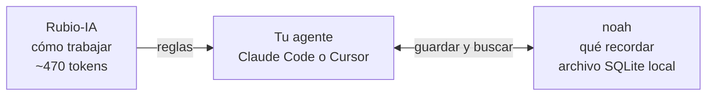

<p align="center">
  
</p>

<h1 align="center">noah</h1>

<p align="center"><b>Memoria persistente para agentes de programación con IA.</b><br>
Un solo archivo, en local, sin cuenta, sin nube, sin servicios en segundo plano.</p>

<p align="center"><a href="README.md">Read in English</a> · <a href="docs/ARCHITECTURE.md">Arquitectura</a> · Licencia: Apache-2.0</p>

---

## Para qué sirve

Los agentes (Claude Code, Cursor…) olvidan todo al terminar la sesión. `noah` les da un cuaderno
con buscador que vive en tu equipo: decisiones tomadas, errores resueltos, convenciones del
proyecto. El agente guarda lo importante mientras trabaja y lo encuentra en la siguiente sesión,
en el proyecto correcto, sin que tengas que pegar contexto.

- **Privado.** Todo queda en un archivo SQLite de tu ordenador. No se envía nada a ningún sitio.
- **Simple.** Un binario. Sin servidor, sin puertos, nada que mantener encendido.
- **Rápido.** Búsquedas en milisegundos; 10.000 memorias ocupan unos 26 MB.
- **Seguro.** Las credenciales se tachan antes de guardarse y una memoria escrita por un agente nunca puede pisar una tuya.
- **Por proyecto.** Cada memoria pertenece al proyecto donde estás y no se mezcla con otros.

> **Estado: v0.4, antes de la 1.0.** Funciona y tiene tests, pero es joven; el formato de almacenamiento y los comandos aún pueden cambiar (las bases de datos se migran solas). Los límites conocidos están [al final](#límites-conocidos).

## noah y Rubio-IA: qué son y cómo encajan

Dos herramientas pequeñas con trabajos distintos. Funcionan mejor juntas, y cada una funciona sola.

| | noah | Rubio-IA |
|---|---|---|
| Qué es | Una memoria: un cuaderno en tu ordenador donde el agente guarda y busca | Un acuerdo de trabajo: un bloque corto en las instrucciones de tu agente |
| Responde a | "¿Qué decidimos la semana pasada?" | "¿Cómo debo trabajar aquí y cuándo uso mi memoria?" |
| Sin la otra | Funciona. El agente guarda cuando se le ocurre | Funciona. Sus reglas de memoria se ignoran y los planes van a `docs/plans/` |



Rubio-IA le dice al agente cuándo consultar y qué merece guardarse; noah lo conserva entre sesiones. Ninguna edita los archivos de la otra y ninguna usa la red.

## Inicio rápido (unos 3 minutos)

**1. Instala las dos.** macOS y Linux:

```sh
curl -fsSL https://raw.githubusercontent.com/dicapower/noah/main/install.sh | sh
curl -fsSL https://raw.githubusercontent.com/dicapower/rubio-ia/main/install.sh | sh
```

Windows (PowerShell, sin permisos de administrador):

```powershell
irm https://raw.githubusercontent.com/dicapower/noah/main/install.ps1 | iex
irm https://raw.githubusercontent.com/dicapower/rubio-ia/main/install.ps1 | iex
```

**2. Conecta noah a tu agente.** Claude Code: `claude mcp add noah --scope user -- noah mcp`. Cursor: ejecuta `noah setup` y sigue lo que imprime (nunca edita tu configuración).

**3. Añade el acuerdo de trabajo.** `rubio setup` (responde en el idioma en que escribes) o `rubio setup --lang es-ES` para español de España.

Abre una terminal nueva si no encuentra un comando, reinicia tu agente y comprueba con `noah doctor` y `rubio doctor`. Después, trabaja con normalidad: *"recuerda que usamos Firebase Auth para el login"*. Arrepentirse es seguro: `rubio remove` quita el acuerdo y cada cambio tiene copia de seguridad previa (`rubio restore`).

## Instalación

Elige una. Todas instalan el mismo binario (`noah`), sin más dependencias.

**macOS y Linux, una línea** (sirve también para actualizar):

```sh
curl -fsSL https://raw.githubusercontent.com/dicapower/noah/main/install.sh | sh
```

Descarga la última release, verifica su checksum y la instala junto a tu `noah` actual (o en `/usr/local/bin`, o en `~/.local/bin` si no se puede escribir). No usa `sudo`; si la carpeta no está en tu `PATH`, imprime la línea para añadirla.

**Homebrew** (macOS y Linux):

```sh
brew tap dicapower/noah https://github.com/dicapower/noah
brew install dicapower/noah/noah
```

**Windows, una línea** (PowerShell, sin permisos de administrador, también sirve para actualizar):

```powershell
irm https://raw.githubusercontent.com/dicapower/noah/main/install.ps1 | iex
```

**Windows con** ([Scoop](https://scoop.sh)):

```powershell
scoop bucket add noah https://github.com/dicapower/noah
scoop install noah
```

**Desde el código** (necesita [Go 1.26+](https://go.dev/dl/)):

```sh
git clone https://github.com/dicapower/noah.git
cd noah
go build -o noah ./cmd/noah
sudo mv noah /usr/local/bin/        # o cualquier carpeta de tu PATH
```

O descarga un archivo ya compilado de la [página de Releases](https://github.com/dicapower/noah/releases) (Linux, macOS y Windows; cada release incluye `SHA256SUMS`). Compruébalo con `noah version`. Consulta [CHANGELOG.md](CHANGELOG.md).

Es Go puro, sin dependencias de C, así que el mismo código compila en macOS, Linux y Windows.

### Actualizar

| Lo instalaste con | Actualiza con |
|---|---|
| el script de instalación | ejecuta otra vez la misma línea `curl … \| sh` |
| Homebrew | `brew update && brew upgrade dicapower/noah/noah` |
| Scoop | `scoop update noah` |
| un archivo descargado | descomprime el nuevo sobre el `noah` antiguo (en Windows cierra antes el agente) y compruébalo con `shasum -a 256 -c SHA256SUMS --ignore-missing` |
| el código | `git pull && go build -o noah ./cmd/noah` y sustituye el binario antiguo |

Después:

1. **Reinicia tu agente** para que lance el binario nuevo. Un agente en marcha sigue usando el antiguo hasta que se reinicia, lo hayas instalado como lo hayas instalado.
2. Ejecuta `noah version` y `noah doctor`. La base de datos se migra sola la primera vez que la abre el binario nuevo; las migraciones solo añaden, y una base de datos de un noah más nuevo se rechaza en lugar de dañarse.
3. Echa un vistazo al [CHANGELOG](CHANGELOG.md) por si cambia algo del comportamiento. Si quieres una copia antes, `noah export > ~/noah-backup.jsonl` (es barato y el único paso que puedes saltarte).

noah nunca se actualiza solo: no hace ninguna conexión de red, por diseño. No hay nada que reinstalar en los hooks de tu agente, que llaman al mismo binario `noah`.

## Conecta tu agente (2 minutos)

`noah setup` imprime los comandos exactos para tu equipo. Nunca modifica tu configuración.

### Claude Code

```sh
claude mcp add noah --scope user -- noah mcp
```

Recomendado: añade estos hooks a `~/.claude/settings.json`. Convierten guardar en un hábito en vez de una esperanza:

```json
{
  "hooks": {
    "SessionStart": [
      { "hooks": [ { "type": "command", "command": "noah hook session-start" } ] }
    ],
    "Stop": [
      { "hooks": [ { "type": "command", "command": "noah hook stop" } ] }
    ]
  }
}
```

- **`SessionStart`** se ejecuta al empezar, reanudar, limpiar o compactar una sesión. Le recuerda al agente cuándo guardar y carga las memorias recientes del proyecto, así no se pierde nada tras una compactación. Funciona incluso en un proyecto sin memorias todavía.
- **`Stop`** (opcional) se ejecuta cuando el agente termina. Si hizo trabajo sustancial (10 o más llamadas a herramientas) y no guardó nada en noah desde entonces, le pide, **una sola vez por sesión**, que guarde lo aprendido antes. Lee el registro de la sesión en local; no interviene ninguna IA. El umbral se cambia con `NOAH_STOP_MIN_TOOLS`.

### Cursor

Añade a `~/.cursor/mcp.json` (o `.cursor/mcp.json` dentro de un proyecto):

```json
{ "mcpServers": { "noah": { "command": "noah", "args": ["mcp"] } } }
```

### Cualquier otro cliente MCP

Ejecuta `noah mcp` como servidor MCP por stdio.

Después, trabaja con normalidad. Pídele a tu agente cosas como *"recuerda que usamos Firebase Auth para el login"* o *"¿qué decidimos sobre la base de datos?"*. El agente decide cuándo guardar y buscar con las herramientas de abajo.

## Si vienes de Engram

Trae tus memorias con un comando. Tu base de datos de Engram solo se lee, desde una copia temporal.

```sh
noah import engram --dry-run     # vista previa: cuenta por proyecto, no escribe nada
noah import engram               # importar (archivo por defecto: ~/.engram/engram.db)
```

Cada proyecto de Engram pasa a ser un proyecto de noah. Se conservan topic keys, tipos, marcas de fijado y fechas originales; se omiten las borradas y las reemplazadas; las credenciales que haya dentro se tachan. Ejecutarlo dos veces no duplica nada. Las memorias importadas quedan marcadas como escritas por un agente; añade `--trust user` si quieres protegerlas de ediciones de agentes.

## Uso desde la terminal

```sh
noah save --kind decision --topic auth/provider "Usamos Firebase Auth con custom claims para roles"
noah search "¿qué proveedor gestiona el login?"
noah search --all "despliegue docker"     # en todos los proyectos
noah context                               # fijadas + más recientes de este proyecto
noah get 42
noah forget 42
```

`--topic` es un nombre estable: guardar de nuevo con el mismo topic actualiza la memoria en vez de duplicarla. `--pin` la mantiene siempre en el contexto.

## Qué recibe el agente

Seis herramientas, pocas a propósito porque cada descripción consume contexto en cada petición (unos 1.000 tokens las seis, comprobado por un test). `mem_search` y `mem_context` aceptan `max_tokens` para que una respuesta nunca inunde la ventana.

| Herramienta | Qué hace |
|---|---|
| `mem_search` | Búsqueda en lenguaje natural; devuelve las mejores coincidencias con un fragmento. Entiende fechas ("hace dos semanas", "el 3 de marzo", "el martes pasado", "two weeks ago") y prioriza las notas de esa época |
| `mem_save` | Guarda una memoria; el mismo `topic` la revisa |
| `mem_get` | Lee una memoria completa |
| `mem_context` | Fijadas, luego decisiones y convenciones, luego las recientes, dentro de un presupuesto de tokens |
| `mem_forget` | Borra una memoria errónea u obsoleta |
| `mem_spaces` | Lista los proyectos y su tamaño |

## Memoria global

Hay conocimiento que vale para todos los proyectos: cómo prefieres trabajar, tu infraestructura de hosting, convenciones generales. Guárdalo en el espacio `global` y aparecerá en todas partes: en el contexto de inicio de sesión y en cada búsqueda de proyecto.

```sh
noah save --space global "Las apps de clientes se despliegan en nuestro Dokploy tras Traefik"
noah move 42 global          # promover una memoria existente a global
noah move 42 mi-proyecto     # o moverla a otro proyecto
```

Los agentes pueden hacer lo mismo guardando con `space: "global"`. Resérvalo para lo que es cierto en todos los proyectos; las notas específicas se quedan en su proyecto.

## Cómo se decide el proyecto

Una memoria pertenece a un *space* (proyecto), elegido en este orden:

1. la variable de entorno `NOAH_SPACE`,
2. el archivo `.noah` más cercano (escribe dentro el nombre del proyecto),
3. el nombre de la carpeta raíz del repositorio git,
4. el nombre de la carpeta actual.

Tu carpeta personal y `/` se agrupan en `_unscoped`. Las búsquedas se quedan en el proyecto actual salvo que pidas todos (`--all`, o `scope: "all"` desde el agente). `noah space` te dice en qué proyecto estás.

> Si tu agente lanza los servidores MCP fuera de la carpeta del proyecto, define `NOAH_SPACE` en su configuración MCP.

## Seguridad

La memoria de agentes es una superficie de ataque: lo que un agente guarda se vuelve a leer en un prompt futuro.

- **Las credenciales no llegan a la base de datos.** Claves de API, tokens, claves privadas y contraseñas en URLs se tachan al guardar. `NOAH_SECRETS=block` rechaza en su lugar; `off` lo desactiva. `noah doctor` revisa lo ya guardado.
- **Dos niveles de confianza.** Lo que guardas desde la terminal es `user`; lo que guarda un agente es `agent`. Un agente no puede sobrescribir, fijar ni borrar una memoria `user`.
- **Notas marcadas.** Una nota que ordena a la IA ignorar sus reglas, ejecuta un comando de descargar-y-ejecutar u oculta caracteres recibe una marca `⚠`. Si la escribió un agente, se puede buscar (con aviso) pero nunca se inyecta sola en una sesión. `noah stale` las lista para revisarlas. Es una heurística: hace visibles los casos comunes, no todos los ataques.
- **Contexto etiquetado.** Las memorias inyectadas van en un bloque que indica que son notas de referencia, no instrucciones, y quién escribió cada una. Una memoria no puede cerrar ese bloque desde dentro.
- **Sin red.** El agente lanza `noah mcp` por stdio. No hay servidor HTTP al que una web pueda acceder. El archivo de base de datos se crea privado (`0600`).

## Todos los comandos

```
noah mcp | setup | hook session-start|stop   integración con agentes
noah save | search | context | get | forget  memorias
noah spaces | space | move                   proyectos
noah import engram                           migrar desde Engram
noah doctor | stale | export | version       mantenimiento
```

`noah <comando> -h` muestra los flags. Los más usados:

| Comando | Flags |
|---|---|
| `noah save [texto\|-]` | `-title`, `-kind` (decision, bugfix, pattern, note…), `-topic` (clave estable: guardar de nuevo con ella revisa la nota), `-tag` (repetible), `-pin`, `-space` |
| `noah search <pregunta>` | `-all` (todos los proyectos), `-kind`, `-limit` (por defecto 8), `-json`, `-space` |
| `noah context` | `-limit` (por defecto 12), `-max-tokens` (por defecto 1500), `-space` |
| `noah stale` | `-days` (por defecto 180), `-limit` (por defecto 30), `-space`. Lista notas que nadie usa desde hace meses y notas marcadas con `⚠` |
| `noah export` | `-space`. `noah export > backup.jsonl` guarda todo en JSON lines |

`noah get <id>` muestra una nota completa (incluido por qué está marcada); `noah forget <id>` la borra; `noah move <id> <espacio>` la mueve.

| Variable de entorno | Significado | Por defecto |
|---|---|---|
| `NOAH_DB` | archivo de base de datos | `~/.noah/noah.db` |
| `NOAH_SPACE` | forzar el proyecto | detectado |
| `NOAH_SECRETS` | `redact`, `block` u `off` | `redact` |
| `NOAH_START_TOKENS` | tope de tamaño del contexto inyectado al empezar la sesión | `1500` |

## Problemas frecuentes

- **`command not found: noah`.** La carpeta con el binario no está en tu `PATH`. El script de instalación imprime la línea para añadirla; o ejecuta `which noah` / `echo $PATH`. Escribir `./noah` desde la carpeta donde está siempre funciona. No pegues comandos con un `# comentario` al final en zsh: por defecto no trata `#` como comentario.
- **El agente no ve las herramientas.** Reinícialo tras añadir el servidor y comprueba la ruta con `which noah`; usa la ruta completa en la configuración si el agente no hereda tu `PATH`.
- **Las búsquedas no devuelven nada.** Puede que estés en un proyecto distinto al de guardado. Ejecuta `noah space`, `noah spaces` o busca con `--all`.
- **Algo no cuadra.** `noah doctor` comprueba la integridad de la base de datos, el índice de búsqueda y las credenciales guardadas.
- **Una nota mía sale marcada con `⚠`.** Ejecuta `noah get <id>` para ver el motivo. Si es una falsa alarma, [abre una issue](https://github.com/dicapower/noah/issues) con la frase que la dispara; el detector es estrecho a propósito y las notas reales son los mejores datos de prueba. `noah forget <id>` borra una nota que ya no quieras.
- **Empezar de cero.** Borra `~/.noah/noah.db` (haz antes copia con `noah export`).

## Rendimiento

Memorias sintéticas de ~900 caracteres en una máquina de 2 vCPU:

| Memorias | Búsqueda típica | Inserciones/s | Tamaño | Preguntas naturales acertadas |
|---:|---:|---:|---:|---:|
| 10.000 | 13–33 ms | ~900 | 26 MB | 50 / 50 |
| 100.000 | 94–280 ms | ~860 | 259 MB | 50 / 50 |

Método y experimentos descartados: [docs/ARCHITECTURE.md](docs/ARCHITECTURE.md).

### Benchmark público: LongMemEval-S

[LongMemEval-S](https://github.com/xiaowu0162/LongMemEval) tiene 500 preguntas, cada una con unas 48 sesiones de chat donde buscar. noah recibe cada pregunta tal cual y cuenta un acierto cuando uno de los primeros resultados sale de una sesión que contiene la respuesta. Se puntúan 470 preguntas (las 30 de abstención no tienen respuesta). Mide solo la recuperación; ningún modelo lee el resultado.

| Una memoria por... | hit@1 | hit@5 | hit@10 |
|---|---:|---:|---:|
| sesión | 88,3 % | 98,1 % | 98,9 % |
| intercambio (usuario + asistente) | 86,4 % | 97,0 % | 98,5 % |

Un orden aleatorio puntúa 18,9 % a 5. La categoría más débil son las preferencias (86,7 % y 80,0 % a 5), donde pregunta y respuesta no comparten palabras: "¿qué debería servir para cenar con mis ingredientes de la huerta?" frente a un chat sobre albahaca y menta. Es el límite "palabras, no significado" de más abajo.

Para reproducirlo (el archivo de datos de 277 MB no está en este repositorio; descarga `longmemeval_s_cleaned.json` de la [página del dataset en Hugging Face](https://huggingface.co/datasets/xiaowu0162/longmemeval-cleaned)):

```sh
NOAH_LONGMEMEVAL=/ruta/longmemeval_s_cleaned.json go test ./internal/search -run TestLongMemEval -v
# NOAH_LME_GRAN=round para memorias por intercambio, NOAH_LME_N=100 para una prueba rápida, NOAH_LME_MISSES=1 para listar los fallos
```

## Límites conocidos

- **Guardar sigue dependiendo del agente.** Los hooks se lo recuerdan en los momentos clave, pero ninguna herramienta puede decidir sola qué merece conservarse.
- **Busca palabras, no significado.** "¿Qué base de datos elegimos?" no encontrará una nota que solo diga "SQLite". Están planificados embeddings opcionales.
- **Una palabra presente en casi todas las memorias es lenta a tamaños muy grandes** (unos 280 ms con 100.000 memorias). Las consultas normales son mucho más rápidas.
- **Sin sincronización entre equipos.** Comparte con `noah export` y Git.
- **El detector `⚠` es una heurística.** Busca una lista corta de frases de inyección conocidas, comandos de descargar-y-ejecutar y caracteres ocultos. No detecta ataques parafraseados, y la v0.4.0 dio falsas alarmas con notas reales antes de estrecharlo en la v0.4.1. Es una alarma de humo, no una garantía.
- La primera tabla sale de datos sintéticos y LongMemEval son transcripciones de chat, no las notas cortas que escribe un agente; con tus notas variará.

## Marca

Los logos, la vista previa compartida y la paleta de colores están descritos en [assets/BRAND.md](assets/BRAND.md) (en inglés).

## Desarrollo

```sh
go vet ./... && go test ./...
NOAH_SCALE=1000,10000 go test ./internal/search -run TestScale -v    # benchmark de escala
CGO_ENABLED=0 GOOS=windows GOARCH=amd64 go build ./cmd/noah           # compilación cruzada
```

## Licencia

Apache License 2.0 — Copyright 2026 DICA POWER OÜ. Ver [LICENSE](LICENSE) y [NOTICE](NOTICE).
